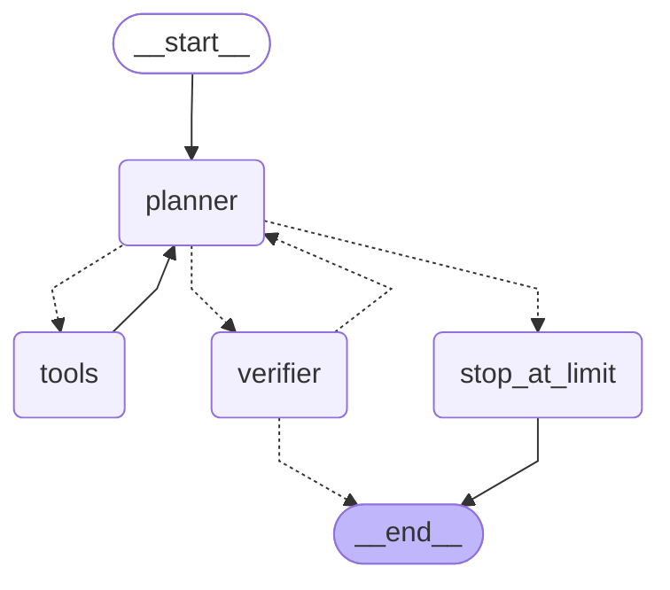

# Agent graph

How a question moves through the agent. Generated from the compiled graph by
`uv run python -m finai.agent.graph`; `tests/test_graph.py` fails if this copy
stops matching the code.

| Step | What happens |
|---|---|
| `planner` | Claude reads the conversation with the system prompt and either answers or asks for tools. Counts the step (`loop_count`). |
| `tools` | Runs the requested tools in parallel; every result goes to `tool_results` and 10-K passages to `retrieved_docs`, for the verifier. Then back to the planner. |
| `verifier` | Checks the draft answer: figures against tool values, citations against what was retrieved, portfolio amounts against a recomputation; if those pass, the LLM critic (Haiku 5.5) checks support and reasoning. Records the `verdict`. |
| `stop_at_limit` | Reached only when the planner still asks for tools at `MAX_AGENT_LOOPS` (6) steps: answers each pending call with "not run" and tells the user, so the saved thread stays valid. |

Solid arrows always happen; dashed arrows are chosen. After each planner step:

| The planner's reply | Next |
|---|---|
| asks for tools, under the step limit | `tools` |
| asks for tools at the step limit | `stop_at_limit` |
| asks for nothing (a draft answer) | `verifier` |

After the verifier:

| Verdict | Next |
|---|---|
| pass | end: the draft is the answer |
| revise, with revisions (`MAX_REVISIONS`, 2) and steps left | `planner`, with the issues as a feedback message |
| revise, a limit reached | end: the draft, with a caveat listing the claims that couldn't be verified |

The loop always ends: each revision uses one of `MAX_REVISIONS` and each
planner step one of `MAX_AGENT_LOOPS`, and neither is reset within a question.
