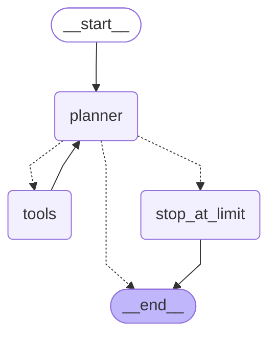

# Agent graph

How a question moves through the agent. Generated from the compiled graph by
`uv run python -m finai.agent.graph`; `tests/test_graph.py` fails if this copy
stops matching the code.

| Step | What happens |
|---|---|
| `planner` | Claude reads the conversation with the system prompt and either answers or asks for tools. Counts the step (`loop_count`). |
| `tools` | Runs the requested tools in parallel and adds their results; 10-K passages also go to `retrieved_docs` for the verifier. Then back to the planner. |
| `stop_at_limit` | Reached only when the planner still asks for tools at `MAX_AGENT_LOOPS` (6) steps: answers each pending call with "not run" and tells the user, so the saved thread stays valid. |

Solid arrows always happen; dashed arrows are chosen after each planner step:

| The planner's reply | Next |
|---|---|
| asks for tools, under the step limit | `tools` |
| asks for tools at the step limit | `stop_at_limit` |
| asks for nothing (the answer) | end |

The verifier (1.5) will sit between the planner's answer and the end.
